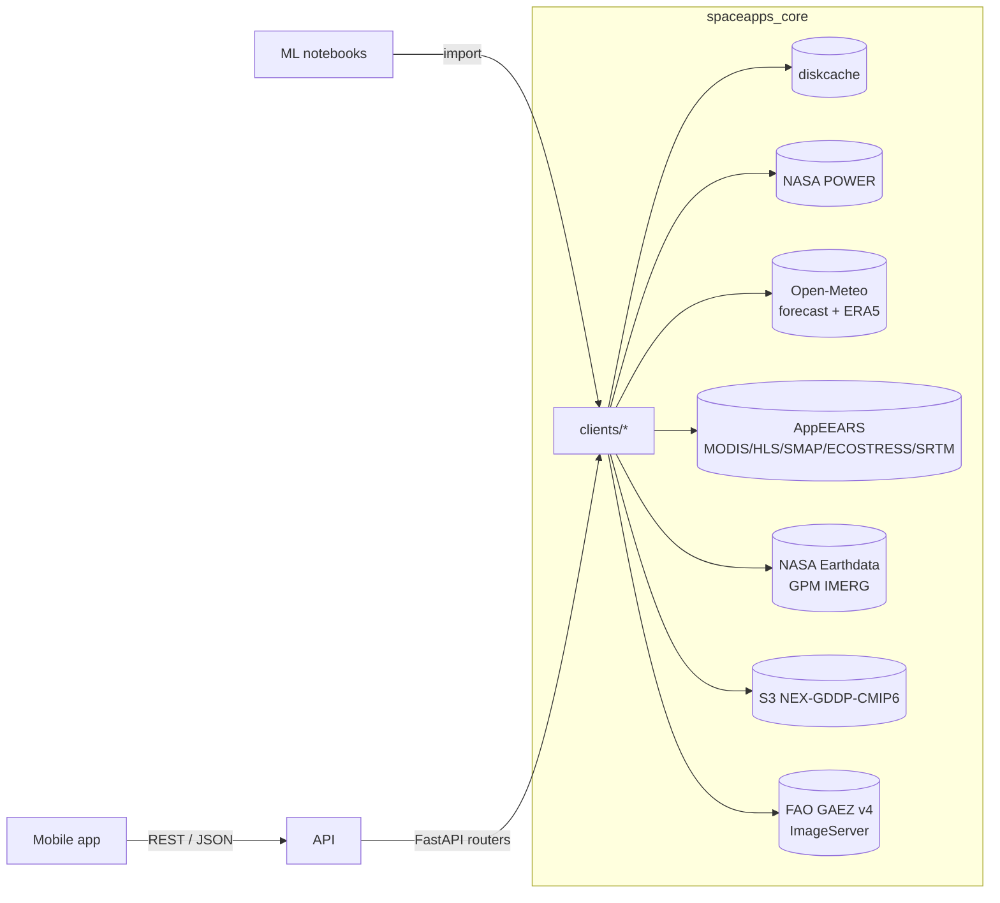

# spaceapps-2026-core

Backend for the **NASA Space Apps 2026** challenge
_"Field Shift: Adapting Farms with NASA Data"_.

It gives both a mobile app and an ML team a single way to pull climate,
precipitation, vegetation, soil-moisture, water-stress, terrain, crop-suitability
and projection data for any point on Earth, normalized into one tabular format. The same Python library that powers
the HTTP API can be imported directly from a notebook, so the ML team does not
need the service running to work with the data.

## Status

Data clients, API shape, caching and connectivity tests are in place, plus a
first **recommendation engine** for the mobile app (`/api/v1/app/*`). The
engine's structure, loading and validation are done; the agronomic values it
reads are still examples (see below).

## Architecture



Every client returns the same `TimeSeries` schema:

```python
class TimeSeries:
    source: str
    variable: CanonicalVariable  # e.g. t2m_mean, precipitation, ndvi, ...
    unit: str
    location: Location
    temporal_resolution: Literal["daily", "hourly", "monthly", "climatology"]
    points: list[TimePoint]  # [{date, value}, ...]
    metadata: dict           # product id, original name/unit, api, ...
```

## Data sources

| Source | What it gives | Resolution | Update cadence | Auth |
|---|---|---|---|---|
| **NASA POWER** (`clients/power.py`) | Daily agroclimatology at a point: temperature (mean/max/min), bias-corrected precipitation, humidity, surface shortwave radiation, wind | ~0.5° | Daily (~1-day latency) | None |
| **Open-Meteo** (`clients/open_meteo.py`) | 1-16 day daily forecast with the same canonical variables | ~0.1° | Hourly refresh | None |
| **ERA5** (`clients/open_meteo.py`) | ECMWF reanalysis since 1940 via Open-Meteo's historical API | ~0.25° | Daily (~5-day latency) | None |
| **AppEEARS** (`clients/appeears.py`) | Asynchronous jobs: MODIS NDVI/EVI, HLS (Landsat + Sentinel-2) NDVI, SMAP soil moisture, ECOSTRESS evaporative stress index, SRTM elevation | 250 m / 30 m / 9 km / 70 m / 30 m | Per-product | Earthdata login |
| **Earthdata / IMERG** (`clients/earthdata.py`) | GPM IMERG daily precipitation + generic search by `short_name` | 0.1° | Daily (final run has ~month latency) | Earthdata login |
| **NEX-GDDP-CMIP6** (`clients/nex_gddp.py`) | Daily downscaled climate projections (SSP1-2.6, SSP2-4.5, SSP3-7.0, SSP5-8.5) | 0.25° | N/A (static CMIP6) | Anonymous S3 |
| **FAO GAEZ v4** (`clients/gaez.py`) | Rainfed crop suitability index (0-1) per crop, 1981-2010 baseline | ~9 km | Static | None |
| **SoilGrids v2.0** (`clients/soilgrids.py`) | Soil properties at a point: sand, clay, organic carbon, pH… | 250 m | Static | None |
| **ORNL DAAC MODIS** (`clients/ornl_modis.py`) | Synchronous MODIS point subsets; used for the MOD13Q1 NDVI history | 250 m | Per 16-day composite | None |

Sources from the Space Apps resource list that only cover the United States
(SSURGO/STATSGO2, Web Soil Survey, CDL, PRISM, NAIP, NLDAS, CoCoRaHS, NWIS,
USDA NASS/AMS, OpenET, LANDFIRE) are intentionally left out: the pilot zone is
Piura, Peru.

## Getting Earthdata credentials

AppEEARS and `earthaccess` need a free Earthdata Login:

1. Register at <https://urs.earthdata.nasa.gov/users/new>.
2. In your dashboard, go to **Applications** and authorize at least:
   - *AppEEARS*
   - *NASA GESDISC DATA ARCHIVE* (needed for GPM IMERG)
3. Put your credentials in `.env`:
   ```
   EARTHDATA_USERNAME=your-user
   EARTHDATA_PASSWORD=your-pass
   ```
   If you leave them empty the service still starts, but Earthdata-backed
   endpoints respond `503 not_configured`.

## Setup

### Local (uv)

```bash
cp .env.example .env
make setup           # creates .venv and installs dev deps with uv
make dev             # starts uvicorn with --reload
```

Then open <http://localhost:8000/docs> for the OpenAPI UI.

### Docker

```bash
cp .env.example .env
make docker-build
make docker-up
```

### CI

See `.github/workflows/ci.yml` — runs `ruff check`, `ruff format --check`,
and the unit test suite. Unit tests never touch the network (every upstream
is stubbed with `respx`).

## Endpoints

| Method | Path | Description |
|---|---|---|
| GET | `/health` | Liveness check |
| GET | `/health/sources` | Probes every upstream in parallel (POWER, Open-Meteo, ERA5, AppEEARS, Earthdata, NEX-GDDP, GAEZ, SoilGrids, ORNL MODIS); returns `ok` / `error` / `not_configured` with per-source latency |
| GET | `/api/v1/climate/history` | NASA POWER daily agroclimatology at a point |
| GET | `/api/v1/climate/forecast` | Open-Meteo 1-16 day daily forecast |
| GET | `/api/v1/climate/reanalysis` | ERA5 daily reanalysis at a point |
| GET | `/api/v1/precipitation` | GPM IMERG daily precipitation (via earthaccess) |
| POST | `/api/v1/vegetation/jobs` | Submit vegetation AppEEARS task (`sensor=modis` NDVI/EVI or `sensor=hls` 30 m NDVI) |
| POST | `/api/v1/soil-moisture/jobs` | Submit SMAP soil-moisture AppEEARS task |
| POST | `/api/v1/water-stress/jobs` | Submit ECOSTRESS evaporative stress index AppEEARS task |
| POST | `/api/v1/terrain/jobs` | Submit SRTM elevation AppEEARS task |
| GET | `/api/v1/jobs/{job_id}` | Check status / parsed result of an AppEEARS task |
| GET | `/api/v1/projections` | NEX-GDDP-CMIP6 projections at a point (SSP2-4.5 default) |
| GET | `/api/v1/crop-suitability` | FAO GAEZ rainfed suitability per crop, most suitable first |
| GET | `/api/v1/features` | Daily multi-source table ready for ML; one column per variable |
| GET | `/api/v1/app/climate-overview` | Ready-to-render summary for the mobile app's Clima screen (Open-Meteo forecast + NASA POWER anomalies) |
| GET | `/api/v1/app/catalog` | Crops, priorities and restrictions the app offers, from `agro_config.json` |
| POST | `/api/v1/app/recommendation` | Rotation recommendation for the three climate scenarios at once (NASA POWER + `agro_config.json`) |

All data endpoints accept `lat`, `lon`, `start`, `end`, and `format=json|csv|parquet`.

## Example — API

```bash
# NASA POWER, five days near the pilot zone (Piura, Peru)
curl "http://localhost:8000/api/v1/climate/history?\
lat=-5.19&lon=-80.63&start=2024-01-01&end=2024-01-05"

# Same request, as CSV
curl -o history.csv "http://localhost:8000/api/v1/climate/history?\
lat=-5.19&lon=-80.63&start=2024-01-01&end=2024-01-05&format=csv"

# Submit an NDVI job on AppEEARS (requires EARTHDATA_* in .env)
curl -X POST "http://localhost:8000/api/v1/vegetation/jobs?\
lat=-5.19&lon=-80.63&start=2024-01-01&end=2024-01-31"

# Poll it later
curl "http://localhost:8000/api/v1/jobs/<job_id>"
```

## Example — Python client (notebook)

```python
import asyncio
from datetime import date
from spaceapps_core.clients.power import PowerClient
from spaceapps_core.schemas.common import Location

async def demo():
    client = PowerClient()
    series = await client.daily_point(
        location=Location(lat=-5.19, lon=-80.63),
        start=date(2024, 1, 1),
        end=date(2024, 1, 31),
    )
    df = PowerClient.to_dataframe(series)
    print(df.head())

asyncio.run(demo())
```

## Connectivity check

```bash
make check-connections
```

Prints a table with `ok` / `error` / `not_configured` per source and latency.
Also usable in CI gates to notice when an upstream is down.

## Recommendation engine (mobile app)

`POST /api/v1/app/recommendation` answers "what should I plant?" with the
farmer's own inputs (location, hectares, planting date, last crop, campaigns in
a row, priority, restrictions, the texture they recognize in their own soil and
optionally a rotation they chained themselves) and five observations of that
point: **NASA POWER** for the climate of each scenario, **SoilGrids** for the
soil under the plot, the **MODIS NDVI** history for how the plot's greenness is
moving, **SMAP** for how wet the topsoil has been and **GPM IMERG** for the
rain the current campaign actually got.

| Input of the challenge | Where it comes from |
|---|---|
| NASA Earth observations | NASA POWER (climate of each scenario), MODIS NDVI (greenness trend), SMAP (topsoil moisture), GPM IMERG (measured rain) |
| Local soil | SoilGrids at the point, plus the texture the farmer picks in the app ("does your soil look like this one?"), which wins over SoilGrids |
| Crops | `crops` in `agro_config.json`: water asked (`water_index` / `water_need`), cycle length and whether it fixes nitrogen |
| Priorities | `priorities` in `agro_config.json`; the response ranks every one of them, so the app re-sorts without asking again |

**Only NASA POWER and the parameter file are required.** SoilGrids, MODIS,
SMAP and IMERG are fail-soft, and the last three take minutes to answer, so
the recommendation reads whatever is already cached for the point and the
endpoint refreshes it in the background: the first farmer on a new plot gets
the recommendation without them, and the next one gets them. SMAP and IMERG
also need Earthdata credentials; with none configured they are simply absent
and `data_sources` says so.

SMAP measures the water of the first 5 cm, not what the roots have stored, so
it is **reported, not used in the irrigation maths**. Turning it into a water
balance is a decision for the agronomy team.

It returns the three climate scenarios at once (`heavy_rains`, `normal`, `dry`)
so the app can switch between them offline, each with irrigation water (m³),
climate-risk months, the planting calendar and the soil outlook over the next
two years. The ranking comes for every priority of the catalog as well, so
changing priority in the app needs no new request. Only POWER is required: if
SoilGrids has no data for the pixel or the NDVI service is down, the response
still succeeds and says so in `data_sources`. `GET /api/v1/app/catalog` serves
the crops, priorities and restrictions. Both are documented in
[docs/API.md](docs/API.md).

Every agronomic value lives in one editable file,
`src/spaceapps_core/data/agro_config.json` (override the path with
`AGRO_CONFIG_PATH`):

| Block | What it holds |
|---|---|
| `crops` | Id, display name, `kc_by_month` (one crop coefficient per month of the cycle; its length is the cycle duration), `soil_impact`, `fixes_nitrogen` and the factsheet texts |
| `rotations` | Id and the ordered list of crop ids |
| `soil_textures` | The answers to "does your soil look like this one?": id (`sandy` / `loamy` / `clayey`), display name and how the farmer recognizes it in their hand |
| `scenarios` | Reference years whose observed POWER climate stands for each scenario |
| `thresholds` | Risk-month rainfall, effective-rain fraction (global and per soil texture), the water-per-hectare limit of "Tendré poca agua", risk levels, the soil rule, the organic-carbon bands, the NDVI-trend window, the water-need bands of a crop, the SMAP moisture bands, how many complete months the SMAP/IMERG window covers and how many crops a farmer can chain |
| `priorities` | Id, display name, short phrase and the ranking `criterion` |
| `restrictions` | Id, display name and what they rule out (`excludes_crop_ids`, `excludes_high_water_use`) |
| `defaults`, `content` | Fallback last crop and the Spanish texts shown by the app (including one finding per soil texture, organic-carbon band and NDVI trend) |

> **The values shipped are examples.** Every block is flagged
> `"_example": true` and the API answers `"example_parameters": true` while any
> of them still is. The data team replaces the numbers in that file; no code
> changes are needed.

All the maths is pure, importable functions — no FastAPI involved — so it can be
driven from a notebook:

```python
from datetime import date
from spaceapps_core.schemas.recommendation import RecommendationRequest
from spaceapps_core.services.agro_config import load_agro_config
from spaceapps_core.services.recommendation import (
    build_recommendation,
    fetch_scenario_climates,
)
from spaceapps_core.schemas.common import Location

config = load_agro_config()          # or load_agro_config("my_params.json")
location = Location(lat=-5.19, lon=-80.63)
climates = await fetch_scenario_climates(location, config.scenarios)
response = build_recommendation(
    RecommendationRequest(
        lat=location.lat,
        lon=location.lon,
        area_ha=2.0,
        planting_date=date(2026, 12, 15),
        last_crop_id="rice",
        consecutive_campaigns=3,
        priority_id="save-water",
    ),
    config,
    climates,
)
print(response.ranking["save-water"]["normal"])
```

`reference_et0` (Hargreaves-Samani, `services/et0.py`) is isolated so a better
method can replace it without touching the engine. `services/local_soil.py`,
`services/vegetation.py`, `services/soil_moisture.py` and
`services/recent_rain.py` hold the SoilGrids, NDVI, SMAP and IMERG logic, also
as pure functions plus one fail-soft fetch each; `build_recommendation` takes
`soil=`, `vegetation=`, `soil_moisture=` and `recent_rain=` so a notebook can
try other values. `services/observations.py` decides the window the satellite
observations cover: complete calendar months ending with last month, so it only
moves once a month and every farmer on the point shares the same cache entry.

### Water availability and the 2024-2025 drought check

Every recommendation carries `water_availability`: total rain (PRECTOTCORR)
and mean root-zone wetness (GWETROOT) of the last 6 complete months at the
point, from NASA POWER, each ranked against the same months of the previous
10 years. The level is the tercile of the mean of both percentile ranks
(`low` / `medium` / `high`); `finding` is the sentence the app shows, built
from those numbers. With `low`, options that include a high-water crop rank
after the others in every priority. The rule is fixed in
`services/water_availability.py`.

A second indicator, `irrigation_water`, approximates the water that
reaches the valley through irrigation. The Chira is irrigated from Poechos,
which fills with the river born in the upper Chira-Catamayo basin, so it
looks at the rain of the last rainy season (December to April) at four NASA
POWER points of that basin, against the same season of the previous 10
years, with the same tercile rule. **It is an approximation with rain, not
the real level of the reservoir**; `note` says so and the app shows it.

| Point | Lat, lon | Why |
|---|---|---|
| Ayabaca (Peru) | -4.64, -79.72 | Upper basin on the Peruvian side; same POWER cell as Macará and Sozoranga |
| Pacaipampa (Peru) | -4.99, -79.67 | Headwaters of the Quiroz, a Chira tributary above Poechos |
| Cariamanga (Ecuador) | -4.33, -79.55 | Calvas river, which joins the Macará and then the Chira |
| Catamayo (Ecuador) | -3.99, -79.36 | Headwaters of the Catamayo (the Chira's name in Ecuador); same cell as Gonzanamá |

The four points are four different POWER cells (0.5 x 0.625 degrees). They
were chosen from the location of those rivers and should be checked against
an official basin map. The ranking uses the less favourable of the two
indicators: with either one `low`, options with a high-water crop go last.

Would it have warned about the water shortage of early 2025? Run both
indicators with data only up to October 2024 for a rice plot of the Chira
valley:

```bash
.venv/bin/python scripts/validate_drought_2024.py           # Marcavelica, as of 2024-11-01
.venv/bin/python scripts/validate_drought_2024.py --lat -4.88 --lon -81.02
```

It prints the indicator, the ranking with and without it, and a three-line
summary. NASA POWER cells are about 0.5 x 0.625 degrees (Sullana and the old
Medio Piura pilot fall in the same cell), so it describes the zone, not the
plot.

### Agronomic parameters and demo plots

`src/spaceapps_core/data/agro_config.json` is versioned. Each block lists in
`_sources` where its values come from; values without a citable source are
marked `referencial` and their block `_example: true`, so
`example_parameters` stays `true` in the response. Two rules apply to every
sequence: no two crops of the same botanical family in a row, and each crop
starts in one of its `planting_months`; a sequence that breaks them gets
`warnings` and never a `low` risk.

Before a demo, warm the two Chira demo plots (Marcavelica and Amotape) so
they answer even if an upstream fails (the endpoints then serve the last
real answer for that request, flagged `X-Served-From: last-good`):

```bash
.venv/bin/python scripts/warm_demo_farms.py
```

## Caching

Every client goes through a shared `diskcache` store (`.cache/` by default).
TTLs per source are configurable via `.env`:

| Variable | Default | Used by |
|---|---|---|
| `CACHE_TTL_FORECAST` | 1800 s | Open-Meteo forecast |
| `CACHE_TTL_HISTORY` | 86400 s | POWER, IMERG, ERA5 |
| `CACHE_TTL_PROJECTIONS` | 604800 s | NEX-GDDP-CMIP6 |
| `CACHE_TTL_STATIC` | 2592000 s | FAO GAEZ catalog and samples |

## Testing

```bash
make test             # unit tests, no network
make test-integration # hits real APIs, auto-skips when creds are missing
make lint             # ruff check
make fmt              # ruff format + ruff check --fix
```

## License

MIT — see [LICENSE](LICENSE). Space Apps requires open-source code.
