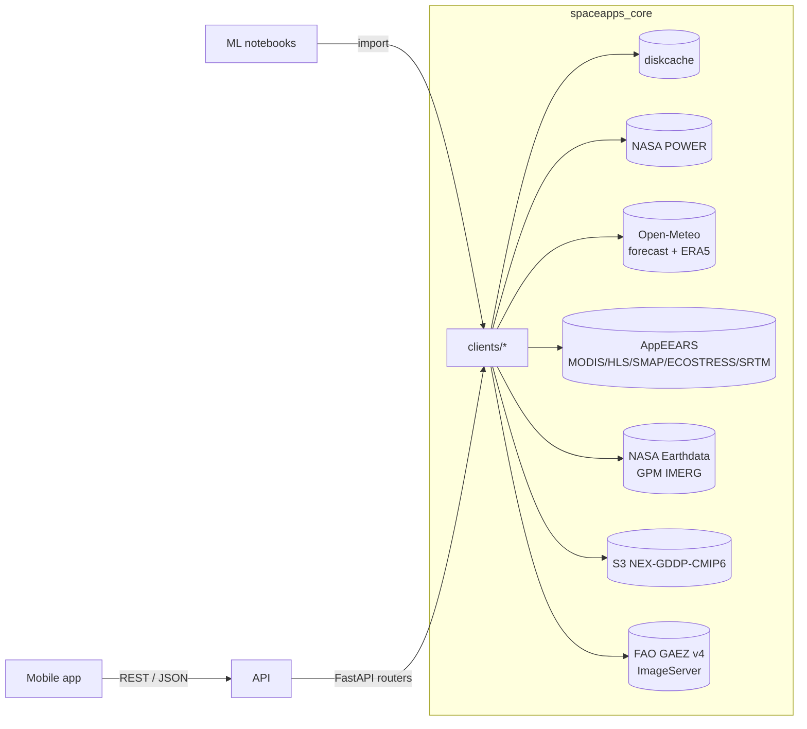

# spaceapps-2026-core

Backend for the **NASA Space Apps 2026** challenge
_"Field Shift: Adapting Farms with NASA Data"_.

It gives both a mobile app and an ML team a single way to pull climate,
precipitation, vegetation, soil-moisture, water-stress, terrain, crop-suitability
and projection data for any point on Earth, normalized into one tabular format. The same Python library that powers
the HTTP API can be imported directly from a notebook, so the ML team does not
need the service running to work with the data.

## Status

Data clients, API shape, caching and connectivity tests are in place, plus a
first **recommendation engine** for the mobile app (`/api/v1/app/*`). The
engine's structure, loading and validation are done; the agronomic values it
reads are still examples (see below).

## Architecture



Every client returns the same `TimeSeries` schema:

```python
class TimeSeries:
    source: str
    variable: CanonicalVariable  # e.g. t2m_mean, precipitation, ndvi, ...
    unit: str
    location: Location
    temporal_resolution: Literal["daily", "hourly", "monthly", "climatology"]
    points: list[TimePoint]  # [{date, value}, ...]
    metadata: dict           # product id, original name/unit, api, ...
```

## Data sources

| Source | What it gives | Resolution | Update cadence | Auth |
|---|---|---|---|---|
| **NASA POWER** (`clients/power.py`) | Daily agroclimatology at a point: temperature (mean/max/min), bias-corrected precipitation, humidity, surface shortwave radiation, wind | ~0.5° | Daily (~1-day latency) | None |
| **Open-Meteo** (`clients/open_meteo.py`) | 1-16 day daily forecast with the same canonical variables | ~0.1° | Hourly refresh | None |
| **ERA5** (`clients/open_meteo.py`) | ECMWF reanalysis since 1940 via Open-Meteo's historical API | ~0.25° | Daily (~5-day latency) | None |
| **AppEEARS** (`clients/appeears.py`) | Asynchronous jobs: MODIS NDVI/EVI, HLS (Landsat + Sentinel-2) NDVI, SMAP soil moisture, ECOSTRESS evaporative stress index, SRTM elevation | 250 m / 30 m / 9 km / 70 m / 30 m | Per-product | Earthdata login |
| **Earthdata / IMERG** (`clients/earthdata.py`) | GPM IMERG daily precipitation + generic search by `short_name` | 0.1° | Daily (final run has ~month latency) | Earthdata login |
| **NEX-GDDP-CMIP6** (`clients/nex_gddp.py`) | Daily downscaled climate projections (SSP1-2.6, SSP2-4.5, SSP3-7.0, SSP5-8.5) | 0.25° | N/A (static CMIP6) | Anonymous S3 |
| **FAO GAEZ v4** (`clients/gaez.py`) | Rainfed crop suitability index (0-1) per crop, 1981-2010 baseline | ~9 km | Static | None |

Sources from the Space Apps resource list that only cover the United States
(SSURGO/STATSGO2, Web Soil Survey, CDL, PRISM, NAIP, NLDAS, CoCoRaHS, NWIS,
USDA NASS/AMS, OpenET, LANDFIRE) are intentionally left out: the pilot zone is
Piura, Peru.

## Getting Earthdata credentials

AppEEARS and `earthaccess` need a free Earthdata Login:

1. Register at <https://urs.earthdata.nasa.gov/users/new>.
2. In your dashboard, go to **Applications** and authorize at least:
   - *AppEEARS*
   - *NASA GESDISC DATA ARCHIVE* (needed for GPM IMERG)
3. Put your credentials in `.env`:
   ```
   EARTHDATA_USERNAME=your-user
   EARTHDATA_PASSWORD=your-pass
   ```
   If you leave them empty the service still starts, but Earthdata-backed
   endpoints respond `503 not_configured`.

## Setup

### Local (uv)

```bash
cp .env.example .env
make setup           # creates .venv and installs dev deps with uv
make dev             # starts uvicorn with --reload
```

Then open <http://localhost:8000/docs> for the OpenAPI UI.

### Docker

```bash
cp .env.example .env
make docker-build
make docker-up
```

### CI

See `.github/workflows/ci.yml` — runs `ruff check`, `ruff format --check`,
and the unit test suite. Unit tests never touch the network (every upstream
is stubbed with `respx`).

## Endpoints

| Method | Path | Description |
|---|---|---|
| GET | `/health` | Liveness check |
| GET | `/health/sources` | Probes every upstream in parallel; returns `ok` / `error` / `not_configured` with per-source latency |
| GET | `/api/v1/climate/history` | NASA POWER daily agroclimatology at a point |
| GET | `/api/v1/climate/forecast` | Open-Meteo 1-16 day daily forecast |
| GET | `/api/v1/climate/reanalysis` | ERA5 daily reanalysis at a point |
| GET | `/api/v1/precipitation` | GPM IMERG daily precipitation (via earthaccess) |
| POST | `/api/v1/vegetation/jobs` | Submit vegetation AppEEARS task (`sensor=modis` NDVI/EVI or `sensor=hls` 30 m NDVI) |
| POST | `/api/v1/soil-moisture/jobs` | Submit SMAP soil-moisture AppEEARS task |
| POST | `/api/v1/water-stress/jobs` | Submit ECOSTRESS evaporative stress index AppEEARS task |
| POST | `/api/v1/terrain/jobs` | Submit SRTM elevation AppEEARS task |
| GET | `/api/v1/jobs/{job_id}` | Check status / parsed result of an AppEEARS task |
| GET | `/api/v1/projections` | NEX-GDDP-CMIP6 projections at a point (SSP2-4.5 default) |
| GET | `/api/v1/crop-suitability` | FAO GAEZ rainfed suitability per crop, most suitable first |
| GET | `/api/v1/features` | Daily multi-source table ready for ML; one column per variable |
| GET | `/api/v1/app/climate-overview` | Ready-to-render summary for the mobile app's Clima screen (Open-Meteo forecast + NASA POWER anomalies) |
| GET | `/api/v1/app/catalog` | Crops, priorities and restrictions the app offers, from `agro_config.json` |
| POST | `/api/v1/app/recommendation` | Rotation recommendation for the three climate scenarios at once (NASA POWER + `agro_config.json`) |

All data endpoints accept `lat`, `lon`, `start`, `end`, and `format=json|csv|parquet`.

## Example — API

```bash
# NASA POWER, five days near the pilot zone (Piura, Peru)
curl "http://localhost:8000/api/v1/climate/history?\
lat=-5.19&lon=-80.63&start=2024-01-01&end=2024-01-05"

# Same request, as CSV
curl -o history.csv "http://localhost:8000/api/v1/climate/history?\
lat=-5.19&lon=-80.63&start=2024-01-01&end=2024-01-05&format=csv"

# Submit an NDVI job on AppEEARS (requires EARTHDATA_* in .env)
curl -X POST "http://localhost:8000/api/v1/vegetation/jobs?\
lat=-5.19&lon=-80.63&start=2024-01-01&end=2024-01-31"

# Poll it later
curl "http://localhost:8000/api/v1/jobs/<job_id>"
```

## Example — Python client (notebook)

```python
import asyncio
from datetime import date
from spaceapps_core.clients.power import PowerClient
from spaceapps_core.schemas.common import Location

async def demo():
    client = PowerClient()
    series = await client.daily_point(
        location=Location(lat=-5.19, lon=-80.63),
        start=date(2024, 1, 1),
        end=date(2024, 1, 31),
    )
    df = PowerClient.to_dataframe(series)
    print(df.head())

asyncio.run(demo())
```

## Connectivity check

```bash
make check-connections
```

Prints a table with `ok` / `error` / `not_configured` per source and latency.
Also usable in CI gates to notice when an upstream is down.

## Recommendation engine (mobile app)

`POST /api/v1/app/recommendation` answers "what should I plant?" with the
farmer's own inputs (location, hectares, planting date, last crop, campaigns in
a row, priority, restrictions) and **NASA POWER only** — no credentials. It
returns the three climate scenarios at once (`heavy_rains`, `normal`, `dry`) so
the app can switch between them offline, each with irrigation water (m³),
climate-risk months, the planting calendar and the soil outlook. The ranking
comes for every priority of the catalog as well, so changing priority in the app
needs no new request. `GET /api/v1/app/catalog` serves the crops, priorities and
restrictions. Both are documented in [docs/API.md](docs/API.md).

Every agronomic value lives in one editable file,
`src/spaceapps_core/data/agro_config.json` (override the path with
`AGRO_CONFIG_PATH`):

| Block | What it holds |
|---|---|
| `crops` | Id, display name, `kc_by_month` (one crop coefficient per month of the cycle; its length is the cycle duration), `soil_impact` and the factsheet texts |
| `rotations` | Id and the ordered list of crop ids |
| `scenarios` | Reference years whose observed POWER climate stands for each scenario |
| `thresholds` | Risk-month rainfall, effective-rain fraction, the water-per-hectare limit of "Tendré poca agua", risk levels and the soil rule |
| `priorities` | Id, display name, short phrase and the ranking `criterion` |
| `restrictions` | Id, display name and what they rule out (`excludes_crop_ids`, `excludes_high_water_use`) |
| `defaults`, `content` | Fallback last crop and the Spanish texts shown by the app |

> **The values shipped are examples.** Every block is flagged
> `"_example": true` and the API answers `"example_parameters": true` while any
> of them still is. The data team replaces the numbers in that file; no code
> changes are needed.

All the maths is pure, importable functions — no FastAPI involved — so it can be
driven from a notebook:

```python
from datetime import date
from spaceapps_core.schemas.recommendation import RecommendationRequest
from spaceapps_core.services.agro_config import load_agro_config
from spaceapps_core.services.recommendation import (
    build_recommendation,
    fetch_scenario_climates,
)
from spaceapps_core.schemas.common import Location

config = load_agro_config()          # or load_agro_config("my_params.json")
location = Location(lat=-5.19, lon=-80.63)
climates = await fetch_scenario_climates(location, config.scenarios)
response = build_recommendation(
    RecommendationRequest(
        lat=location.lat,
        lon=location.lon,
        area_ha=2.0,
        planting_date=date(2026, 12, 15),
        last_crop_id="rice",
        consecutive_campaigns=3,
        priority_id="save-water",
    ),
    config,
    climates,
)
print(response.ranking["save-water"]["normal"])
```

`reference_et0` (Hargreaves-Samani, `services/et0.py`) is isolated so a better
method can replace it without touching the engine.

## Caching

Every client goes through a shared `diskcache` store (`.cache/` by default).
TTLs per source are configurable via `.env`:

| Variable | Default | Used by |
|---|---|---|
| `CACHE_TTL_FORECAST` | 1800 s | Open-Meteo forecast |
| `CACHE_TTL_HISTORY` | 86400 s | POWER, IMERG, ERA5 |
| `CACHE_TTL_PROJECTIONS` | 604800 s | NEX-GDDP-CMIP6 |
| `CACHE_TTL_STATIC` | 2592000 s | FAO GAEZ catalog and samples |

## Testing

```bash
make test             # unit tests, no network
make test-integration # hits real APIs, auto-skips when creds are missing
make lint             # ruff check
make fmt              # ruff format + ruff check --fix
```

## License

MIT — see [LICENSE](LICENSE). Space Apps requires open-source code.
