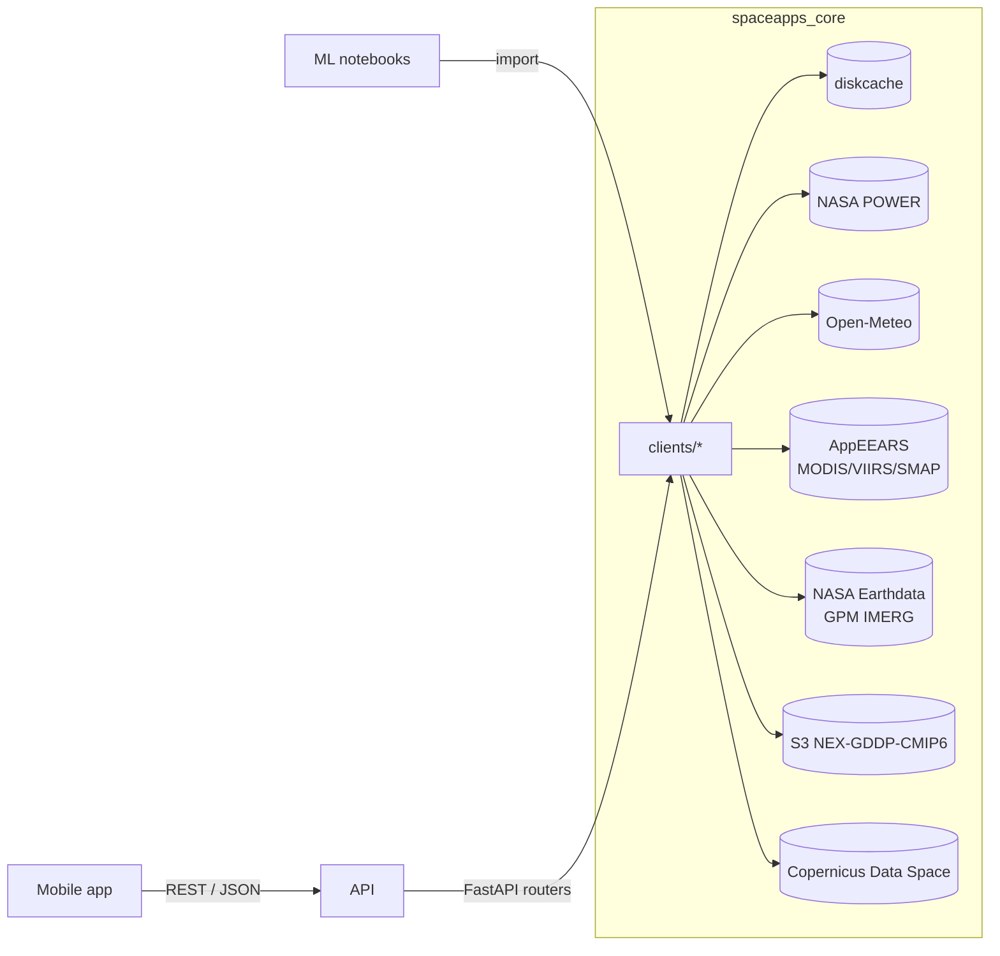

# spaceapps-2026-core

Backend for the **NASA Space Apps 2026** challenge
_"Field Shift: Adapting Farms with NASA Data"_.

It gives both a mobile app and an ML team a single way to pull climate,
precipitation, vegetation, soil-moisture and projection data for any point on
Earth, normalized into one tabular format. The same Python library that powers
the HTTP API can be imported directly from a notebook, so the ML team does not
need the service running to work with the data.

## Status

This repository is intentionally scoped as **infrastructure, not business
logic**: data clients, API shape, caching and connectivity tests are in place,
but the recommendation engine itself (how to translate the data into advice for
farmers) is left for the hackathon weekend.

## Architecture



Every client returns the same `TimeSeries` schema:

```python
class TimeSeries:
    source: str
    variable: CanonicalVariable  # e.g. t2m_mean, precipitation, ndvi, ...
    unit: str
    location: Location
    temporal_resolution: Literal["daily", "hourly", "monthly", "climatology"]
    points: list[TimePoint]  # [{date, value}, ...]
    metadata: dict           # product id, original name/unit, api, ...
```

## Data sources

| Source | What it gives | Resolution | Update cadence | Auth |
|---|---|---|---|---|
| **NASA POWER** (`clients/power.py`) | Daily agroclimatology at a point: temperature (mean/max/min), bias-corrected precipitation, humidity, surface shortwave radiation, wind | ~0.5° | Daily (~1-day latency) | None |
| **Open-Meteo** (`clients/open_meteo.py`) | 1-16 day daily forecast with the same canonical variables | ~0.1° | Hourly refresh | None |
| **AppEEARS** (`clients/appeears.py`) | MODIS/VIIRS NDVI/EVI and SMAP soil moisture, asynchronous job flow | Product-native (250 m / 500 m / 9 km) | Per-product | Earthdata login |
| **Earthdata / IMERG** (`clients/earthdata.py`) | GPM IMERG daily precipitation + generic search by `short_name` | 0.1° | Daily (final run has ~month latency) | Earthdata login |
| **NEX-GDDP-CMIP6** (`clients/nex_gddp.py`) | Daily downscaled climate projections (SSP1-2.6, SSP2-4.5, SSP3-7.0, SSP5-8.5) | 0.25° | N/A (static CMIP6) | Anonymous S3 |
| **Copernicus Data Space** (`clients/copernicus.py`) | Sentinel-2 scene search (NDVI computation = TODO) | 10-60 m | Every 5 days | Public STAC (no auth for search) |

## Getting Earthdata credentials

AppEEARS and `earthaccess` need a free Earthdata Login:

1. Register at <https://urs.earthdata.nasa.gov/users/new>.
2. In your dashboard, go to **Applications** and authorize at least:
   - *AppEEARS*
   - *NASA GESDISC DATA ARCHIVE* (needed for GPM IMERG)
3. Put your credentials in `.env`:
   ```
   EARTHDATA_USERNAME=your-user
   EARTHDATA_PASSWORD=your-pass
   ```
   If you leave them empty the service still starts, but Earthdata-backed
   endpoints respond `503 not_configured`.

## Setup

### Local (uv)

```bash
cp .env.example .env
make setup           # creates .venv and installs dev deps with uv
make dev             # starts uvicorn with --reload
```

Then open <http://localhost:8000/docs> for the OpenAPI UI.

### Docker

```bash
cp .env.example .env
make docker-build
make docker-up
```

### CI

See `.github/workflows/ci.yml` — runs `ruff check`, `ruff format --check`,
and the unit test suite. Unit tests never touch the network (every upstream
is stubbed with `respx`).

## Endpoints

| Method | Path | Description |
|---|---|---|
| GET | `/health` | Liveness check |
| GET | `/health/sources` | Probes every upstream in parallel; returns `ok` / `error` / `not_configured` with per-source latency |
| GET | `/api/v1/climate/history` | NASA POWER daily agroclimatology at a point |
| GET | `/api/v1/climate/forecast` | Open-Meteo 1-16 day daily forecast |
| GET | `/api/v1/precipitation` | GPM IMERG daily precipitation (via earthaccess) |
| POST | `/api/v1/vegetation/jobs` | Submit MODIS NDVI/EVI AppEEARS task |
| POST | `/api/v1/soil-moisture/jobs` | Submit SMAP soil-moisture AppEEARS task |
| GET | `/api/v1/jobs/{job_id}` | Check status / parsed result of an AppEEARS task |
| GET | `/api/v1/projections` | NEX-GDDP-CMIP6 projections at a point (SSP2-4.5 default) |
| GET | `/api/v1/sentinel-2/scenes` | Sentinel-2 scene search (Copernicus STAC) |
| GET | `/api/v1/features` | Daily multi-source table ready for ML; one column per variable |

All data endpoints accept `lat`, `lon`, `start`, `end`, and `format=json|csv|parquet`.

## Example — API

```bash
# NASA POWER, five days near the pilot zone (Piura, Peru)
curl "http://localhost:8000/api/v1/climate/history?\
lat=-5.19&lon=-80.63&start=2024-01-01&end=2024-01-05"

# Same request, as CSV
curl -o history.csv "http://localhost:8000/api/v1/climate/history?\
lat=-5.19&lon=-80.63&start=2024-01-01&end=2024-01-05&format=csv"

# Submit an NDVI job on AppEEARS (requires EARTHDATA_* in .env)
curl -X POST "http://localhost:8000/api/v1/vegetation/jobs?\
lat=-5.19&lon=-80.63&start=2024-01-01&end=2024-01-31"

# Poll it later
curl "http://localhost:8000/api/v1/jobs/<job_id>"
```

## Example — Python client (notebook)

```python
import asyncio
from datetime import date
from spaceapps_core.clients.power import PowerClient
from spaceapps_core.schemas.common import Location

async def demo():
    client = PowerClient()
    series = await client.daily_point(
        location=Location(lat=-5.19, lon=-80.63),
        start=date(2024, 1, 1),
        end=date(2024, 1, 31),
    )
    df = PowerClient.to_dataframe(series)
    print(df.head())

asyncio.run(demo())
```

## Connectivity check

```bash
make check-connections
```

Prints a table with `ok` / `error` / `not_configured` per source and latency.
Also usable in CI gates to notice when an upstream is down.

## Caching

Every client goes through a shared `diskcache` store (`.cache/` by default).
TTLs per source are configurable via `.env`:

| Variable | Default | Used by |
|---|---|---|
| `CACHE_TTL_FORECAST` | 1800 s | Open-Meteo forecast |
| `CACHE_TTL_HISTORY` | 86400 s | POWER, IMERG |
| `CACHE_TTL_PROJECTIONS` | 604800 s | NEX-GDDP-CMIP6 |
| `CACHE_TTL_SATELLITE` | 43200 s | Copernicus scene search |

## Testing

```bash
make test             # unit tests, no network
make test-integration # hits real APIs, auto-skips when creds are missing
make lint             # ruff check
make fmt              # ruff format + ruff check --fix
```

## License

MIT — see [LICENSE](LICENSE). Space Apps requires open-source code.
